<a href="https://a2baid.netlify.app"><picture><source media="(max-width: 768px) and (prefers-color-scheme: dark)" srcset="assets/hero-m-dark.svg"><source media="(max-width: 768px)" srcset="assets/hero-m-light.svg"><source media="(prefers-color-scheme: dark)" srcset="assets/hero-dark.svg"></picture></a>

<picture><source media="(max-width: 768px) and (prefers-color-scheme: dark)" srcset="assets/facts-m-dark.svg"><source media="(max-width: 768px)" srcset="assets/facts-m-light.svg"><source media="(prefers-color-scheme: dark)" srcset="assets/facts-dark.svg"></picture>

<a href="https://a2baid.netlify.app/Anay_Baid_Resume.pdf"><picture><source media="(prefers-color-scheme: dark)" srcset="assets/btn-resume-dark.svg"></picture></a> <a href="https://a2baid.netlify.app"><picture><source media="(prefers-color-scheme: dark)" srcset="assets/btn-portfolio-dark.svg"></picture></a> <a href="https://linkedin.com/in/anaybaid"><picture><source media="(prefers-color-scheme: dark)" srcset="assets/btn-linkedin-dark.svg"></picture></a> <a href="mailto:a2baid@uwaterloo.ca"><picture><source media="(prefers-color-scheme: dark)" srcset="assets/btn-email-dark.svg"></picture></a>

<picture><source media="(max-width: 768px) and (prefers-color-scheme: dark)" srcset="assets/h-experience-m-dark.svg"><source media="(max-width: 768px)" srcset="assets/h-experience-m-light.svg"><source media="(prefers-color-scheme: dark)" srcset="assets/h-experience-dark.svg"></picture>

<picture><source media="(max-width: 768px) and (prefers-color-scheme: dark)" srcset="assets/career-m-dark.svg"><source media="(max-width: 768px)" srcset="assets/career-m-light.svg"><source media="(prefers-color-scheme: dark)" srcset="assets/career-dark.svg"></picture>

<picture><source media="(max-width: 768px) and (prefers-color-scheme: dark)" srcset="assets/job-purolator-m-dark.svg"><source media="(max-width: 768px)" srcset="assets/job-purolator-m-light.svg"><source media="(prefers-color-scheme: dark)" srcset="assets/job-purolator-dark.svg">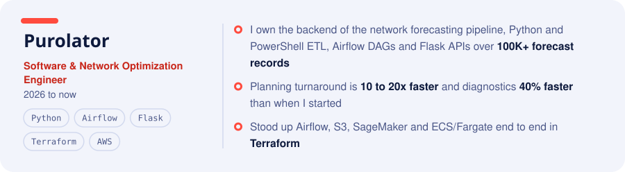</picture>

<picture><source media="(max-width: 768px) and (prefers-color-scheme: dark)" srcset="assets/job-iotum-m-dark.svg"><source media="(max-width: 768px)" srcset="assets/job-iotum-m-light.svg"><source media="(prefers-color-scheme: dark)" srcset="assets/job-iotum-dark.svg">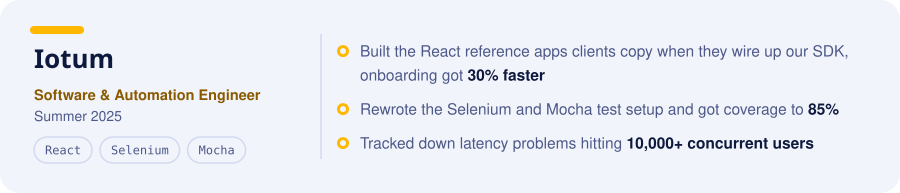</picture>

<b>Earlier roles, Nationwide Appraisals, Cineplex, Alterra Mountain Co.</b>

 

<picture><source media="(max-width: 768px) and (prefers-color-scheme: dark)" srcset="assets/job-nationwide-m-dark.svg"><source media="(max-width: 768px)" srcset="assets/job-nationwide-m-light.svg"><source media="(prefers-color-scheme: dark)" srcset="assets/job-nationwide-dark.svg">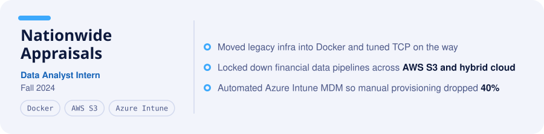</picture>

<picture><source media="(max-width: 768px) and (prefers-color-scheme: dark)" srcset="assets/job-cineplex-m-dark.svg"><source media="(max-width: 768px)" srcset="assets/job-cineplex-m-light.svg"><source media="(prefers-color-scheme: dark)" srcset="assets/job-cineplex-dark.svg">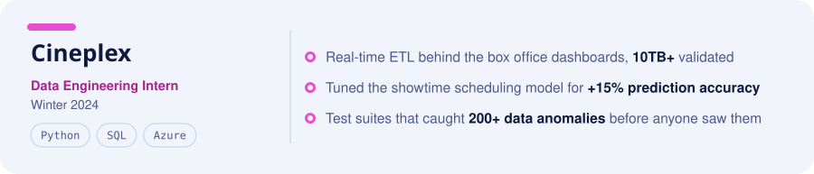</picture>

<picture><source media="(max-width: 768px) and (prefers-color-scheme: dark)" srcset="assets/job-alterra-m-dark.svg"><source media="(max-width: 768px)" srcset="assets/job-alterra-m-light.svg"><source media="(prefers-color-scheme: dark)" srcset="assets/job-alterra-dark.svg">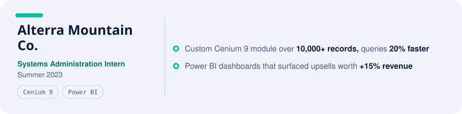</picture>

 

<picture><source media="(max-width: 768px) and (prefers-color-scheme: dark)" srcset="assets/h-projects-m-dark.svg"><source media="(max-width: 768px)" srcset="assets/h-projects-m-light.svg"><source media="(prefers-color-scheme: dark)" srcset="assets/h-projects-dark.svg"></picture>

<a href="https://github.com/anaybaid7/insight-vault"><picture><source media="(max-width: 768px) and (prefers-color-scheme: dark)" srcset="assets/proj-insight-vault-m-dark.svg"><source media="(max-width: 768px)" srcset="assets/proj-insight-vault-m-light.svg"><source media="(prefers-color-scheme: dark)" srcset="assets/proj-insight-vault-dark.svg">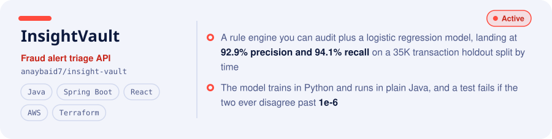</picture></a>

<a href="https://github.com/anaybaid7/starrez-logger-prod"><picture><source media="(max-width: 768px) and (prefers-color-scheme: dark)" srcset="assets/proj-starrez-m-dark.svg"><source media="(max-width: 768px)" srcset="assets/proj-starrez-m-light.svg"><source media="(prefers-color-scheme: dark)" srcset="assets/proj-starrez-dark.svg">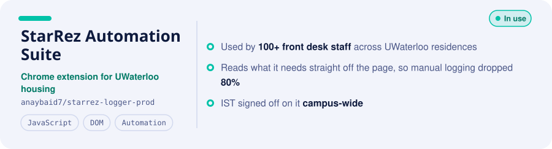</picture></a>

<a href="https://devpost.com/software/github-build-trigger-application"><picture><source media="(max-width: 768px) and (prefers-color-scheme: dark)" srcset="assets/proj-build-trigger-m-dark.svg"><source media="(max-width: 768px)" srcset="assets/proj-build-trigger-m-light.svg"><source media="(prefers-color-scheme: dark)" srcset="assets/proj-build-trigger-dark.svg">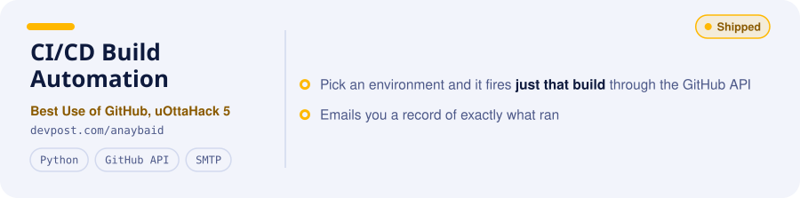</picture></a>

<b>More projects, MERN E-Commerce, Box Office Data Pipeline</b>

 

<a href="https://mern-store-gold.vercel.app/"><picture><source media="(max-width: 768px) and (prefers-color-scheme: dark)" srcset="assets/proj-mern-store-m-dark.svg"><source media="(max-width: 768px)" srcset="assets/proj-mern-store-m-light.svg"><source media="(prefers-color-scheme: dark)" srcset="assets/proj-mern-store-dark.svg">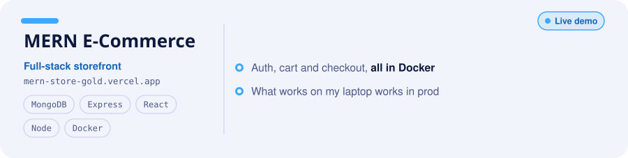</picture></a>

<picture><source media="(max-width: 768px) and (prefers-color-scheme: dark)" srcset="assets/proj-box-office-m-dark.svg"><source media="(max-width: 768px)" srcset="assets/proj-box-office-m-light.svg"><source media="(prefers-color-scheme: dark)" srcset="assets/proj-box-office-dark.svg">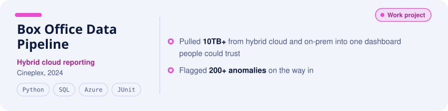</picture>

<picture><source media="(max-width: 768px) and (prefers-color-scheme: dark)" srcset="assets/live-m-dark.svg"><source media="(max-width: 768px)" srcset="assets/live-m-light.svg"><source media="(prefers-color-scheme: dark)" srcset="assets/live-dark.svg">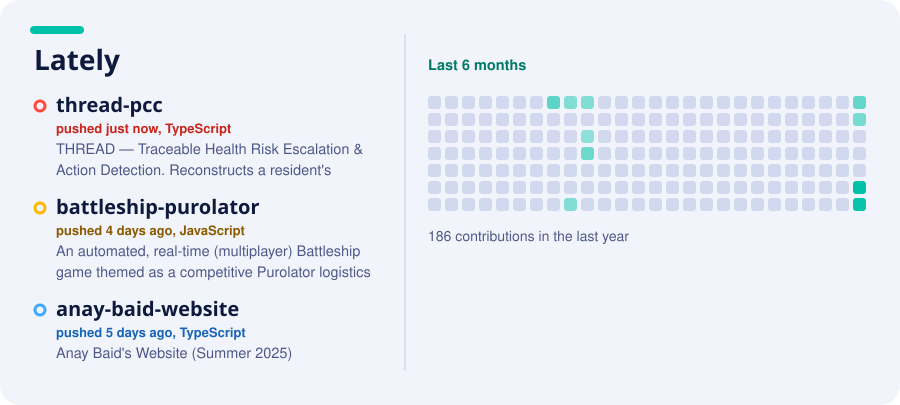</picture>

 

<picture><source media="(max-width: 768px) and (prefers-color-scheme: dark)" srcset="assets/h-stack-m-dark.svg"><source media="(max-width: 768px)" srcset="assets/h-stack-m-light.svg"><source media="(prefers-color-scheme: dark)" srcset="assets/h-stack-dark.svg"></picture>

<picture><source media="(max-width: 768px) and (prefers-color-scheme: dark)" srcset="assets/stack-m-dark.svg"><source media="(max-width: 768px)" srcset="assets/stack-m-light.svg"><source media="(prefers-color-scheme: dark)" srcset="assets/stack-dark.svg">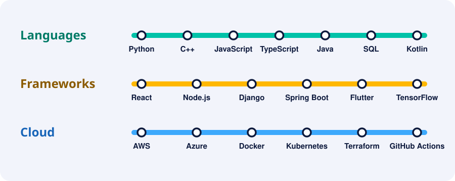</picture>

 

<picture><source media="(max-width: 768px) and (prefers-color-scheme: dark)" srcset="assets/h-education-m-dark.svg"><source media="(max-width: 768px)" srcset="assets/h-education-m-light.svg"><source media="(prefers-color-scheme: dark)" srcset="assets/h-education-dark.svg"></picture>

<picture><source media="(max-width: 768px) and (prefers-color-scheme: dark)" srcset="assets/edu-m-dark.svg"><source media="(max-width: 768px)" srcset="assets/edu-m-light.svg"><source media="(prefers-color-scheme: dark)" srcset="assets/edu-dark.svg"></picture>

 

<a href="mailto:a2baid@uwaterloo.ca"><picture><source media="(max-width: 768px) and (prefers-color-scheme: dark)" srcset="assets/footer-m-dark.svg"><source media="(max-width: 768px)" srcset="assets/footer-m-light.svg"><source media="(prefers-color-scheme: dark)" srcset="assets/footer-dark.svg"></picture></a>
